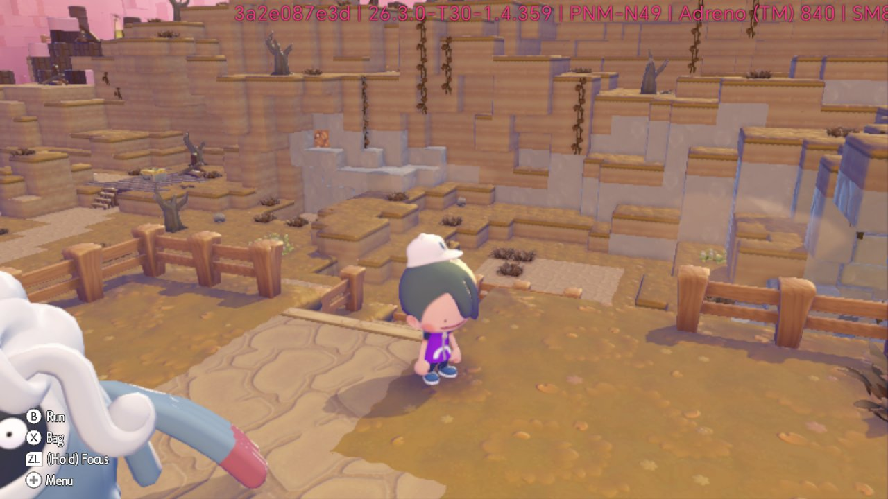
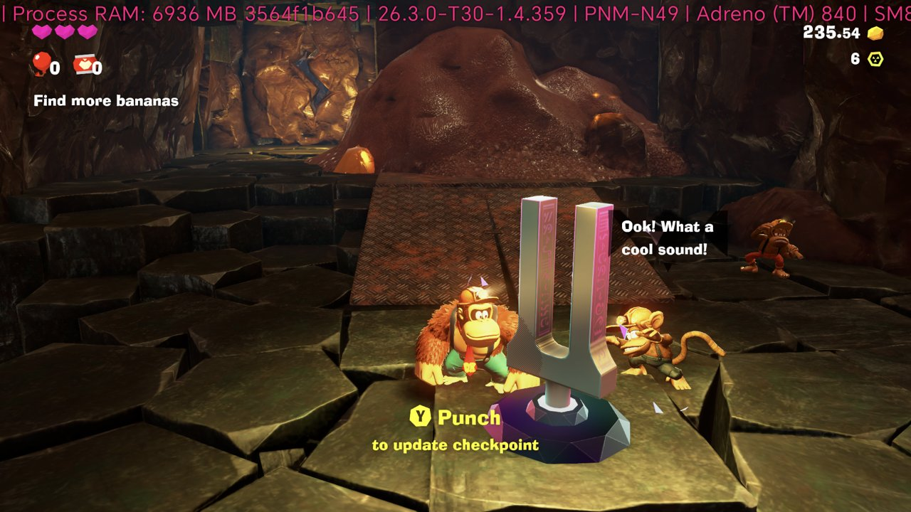
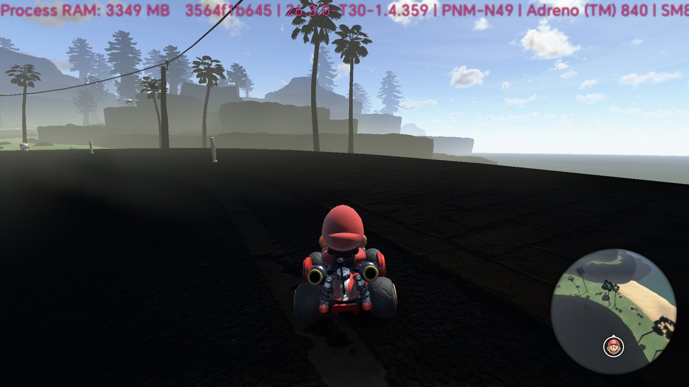
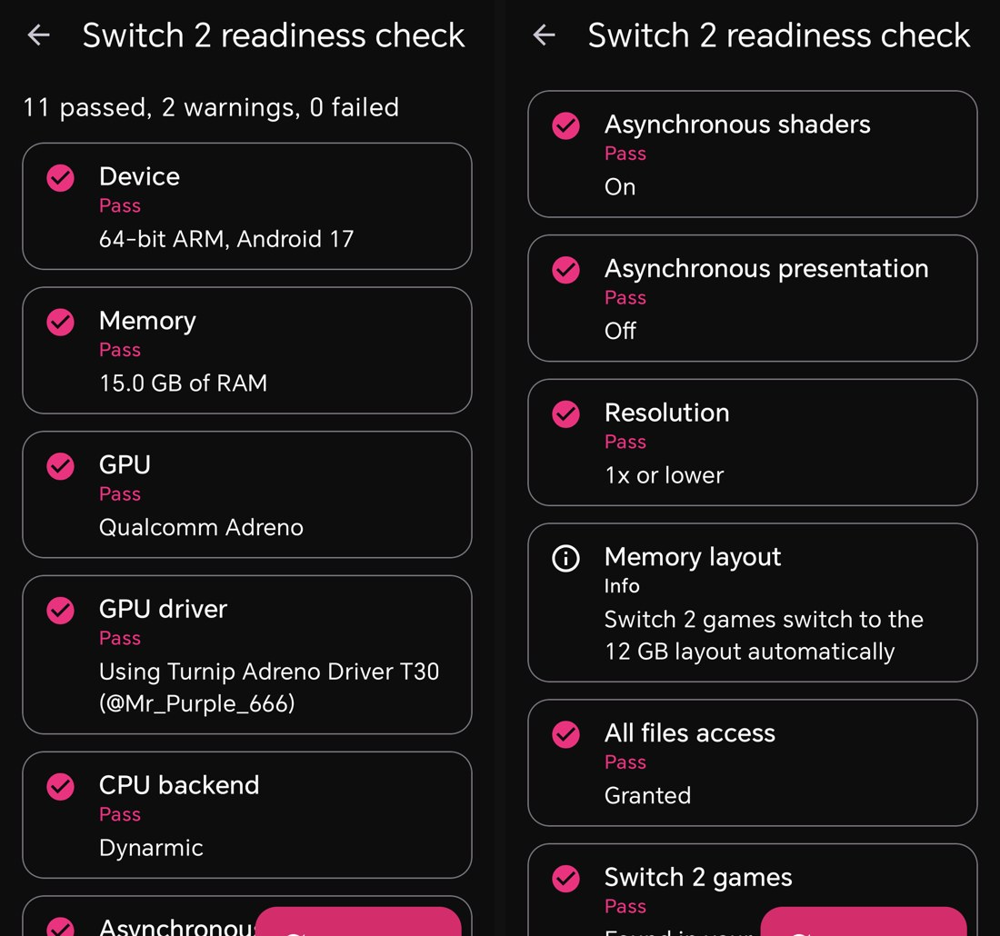

> [!IMPORTANT]
> **AI disclaimer:** most of this fork's Android port (the code, docs and tooling on top of PokeDinner) was written
> with the help of an AI coding assistant (Claude), then checked and tested by hand on one phone. It is
> experimental and can have bugs.

> [!WARNING]
> **This is not the official Eden app, and the Eden team does not support it.**
> Please don't report problems with this app to Eden, PokeDinner, Eglantine, Eden-NS2 or Takoroka.

> [!NOTE]
> **This is an experiment, not an actively maintained project.** Updates may stop at any time. Anyone can fork this
> repo and keep going. The real work is done by the original emulator projects: please contribute to them and give them
> a star: [Eden](https://git.eden-emu.dev/eden-emu/eden),
> [PokeDinner](https://git.eden-emu.dev/Franseven/PokeDinner-a-Eglantine-Fork),
> [Eglantine](https://github.com/Djihads80/Eglantine), [Eden-NS2](https://github.com/0x2593/Eden-NS2) and
> [Takoroka's eden-nx2](https://git.eden-emu.dev/Takoroka/eden-nx2).

# Eden SX2A

<p>



</p>

Screenshots from the test phone. The line at the top is the app's FPS counter.

This app is based on [PokeDinner](https://git.eden-emu.dev/Franseven/PokeDinner-a-Eglantine-Fork), a fork of
Eglantine that collects fixes from other community forks. Version 0.3 moved to this base, so expect new bugs.
v0.2.1 and v0.2.2 were based on [Eden-NS2](https://github.com/0x2593/Eden-NS2), older versions on
[Takoroka's eden-nx2](https://git.eden-emu.dev/Takoroka/eden-nx2). PokeDinner's own README is further down.

You don't need to change any settings. Everything is already set up.

## What you need

- An Android phone with **Android 13 or newer**.
- **16 GB of RAM** is best. 12 GB may work for small games.
- A phone with an **Adreno** GPU (most Snapdragon phones). Other phones are not tested.
- Your own Switch 2 games, as **loose folders** (a folder with `exefs` and `romfs` inside). NSP and XCI files do
  not work for Switch 2 games.
- You do **not** need keys or firmware for Switch 2 games.

## How to start (5 steps)

1. **Download** the APK from this page: **Releases** → newest version.
2. **Install** it. The app is called **Eden SX2A**.
3. **Open the app.** It picks the right graphics driver for you.
4. **Add your games** (see below).
5. **Tap a game.** The first start shows a black screen for a few minutes. This is normal. Wait.

## How to add your games

You have two ways. Both find your games for you.

### Way 1: add your games folder (best)

The app looks inside the folder and finds every game by itself.

1. Put all your games in one folder, for example `Switch2`.
2. In the app, add that folder as a **game folder** (Settings → **Game folders** → **Add game folder**).
3. When the app asks for **All files access**, say **yes**. Games don't start without it.
4. Your games show up in the list. If a game has an update, the app shows the newest one.

**Deep scan:** if your games are far inside other folders (for example you picked the whole phone storage), turn on
**deep scan** for that folder. The app then looks deeper. It is slower, but it finds more.

### Way 2: pick one game

1. In the games list, tap the **folder button**.
2. Tap **Launch ExeFS game folder**.
3. Pick the folder of one game. The app looks inside and finds the game by itself.
4. If it finds more than one version, it asks which one you want. The newest is at the top.

### Folders the app understands

```
Switch2/
  Game Name/
    exefs/ and romfs/              <- a game
  Other Game/
    base/                          <- the game
    updates/123456/                <- an update (the app picks the newest)
    dlc/<title id>/<version>/romfs <- extra content
```

## Check your phone: "Switch 2 readiness check"

Open **Settings** → **Switch 2 readiness check** (the first item).

It checks your phone and shows what is missing:

- **Pass** = good
- **Warning** = may cause problems
- **Fail** = you must fix this

Most items have a **button** that takes you to the right place to fix it. Tap **Run again** after you fix something.

It checks: Android version, RAM, graphics chip and driver, settings, All files access, if games were found, free space,
battery setting, how the app ended last time (closed normally, out of memory, crashed or stopped responding), and if
Android closed the app to free memory in the last 7 days.

**Share report** (bottom left) makes one file with your phone details, the check results and the app's logs. Send that
file when you report a problem.



## Which games work

Tested on one phone (Snapdragon SM8850, 16 GB RAM).

| Game | Works? |
| --- | --- |
| Pokémon Pokopia (update 327680) | ✅ **Playable**, about 20-30 FPS with the right colours. First start is slow |
| Donkey Kong Bananza (update 458752) | ⚠️ **Runs slowly**, about 10 FPS, lower in some places. Slow loading |
| Mario Kart World (1.0.0, no update) | ⚠️ **In game, with black textures** |
| Nintendo Switch 2 Welcome Tour | ❓ Not tested on this version |
| Other games | ❓ Not tested. Tell us how they run |

## If something goes wrong

**First, open the Switch 2 readiness check.** It finds most problems.

**My game is not in the list.**
- Did you allow **All files access**? You need it.
- Is the game inside the folder you added? If it is deep inside other folders, turn on **deep scan**.
- Pull down the list to refresh it.
- You can always use **Way 2** (pick one game).

**Black screen after I tap a game.**
- **Wait a few minutes.** The first start is slow.
- Keep the screen **on** and the app **open**. The game pauses in the background.
- Donkey Kong Bananza asks about accessibility the first time: press **A**.
- Black for a very long time? Your game files may be broken. Dump the game again.

**The app closes by itself.**
- Open the readiness check. **Memory killer** shows if Android closed the app to free memory, and **Battery usage**
  shows if Android limits the app.
- Your phone ran out of memory. Close other apps first.
- Set the battery setting for Eden SX2A to **Unrestricted**.
- Turn off "app freezer" or "memory saver" for Eden SX2A, if your phone has it.

**The game is slow.**
- Close other apps. Let the phone cool down.
- Skip videos in the game if you can. Videos are slow.

**Switching to another game.** Close Eden SX2A first (swipe it away from recent apps), then open it again.

**Still stuck?** Open the readiness check, tap **Share report**, and send the file (Settings → **Share debug logs**
sends the same file). It has your phone model, RAM and
the logs. Do it right after the problem, before you start a game again.

## Known problems

- This version is new. Expect bugs.
- Games run slowly (low FPS). Donkey Kong Bananza runs at about 10 FPS.
- Mario Kart World has black textures.
- The first start of a game is slow. Later starts are faster.
- The phone's own graphics driver (not the bundled one) misses some graphics. Use the bundled driver.
- Videos in games can be slow.

## Please be careful

- **Only use games you own.** This app has no games, keys or firmware.
- **Only download the app from this page.** Other copies could be fake.
- **All files access** lets the app see all your files. You can turn it off when you are done playing.
- Your phone **gets hot** and the **battery drains fast**.
- **Back up your saves** (`Android/data/dev.eden.nx2/files/`). The app can crash.

## Updating

Install the new APK over the old one. Your settings and saves stay.

The app installs next to the official Eden app (it is a separate app: `dev.eden.nx2`).

## For developers

Built on PokeDinner 2.0.0. On top of it:

- **Android app:** loose ExeFS dumps launched by real path and listed from game folders, the Switch 2 readiness check,
  loose DLC, 10 GB and 12 GB memory layouts, Switch 2 defaults, the bundled Turnip driver (Mr. Purple's Turnip T30,
  Mesa, MIT licence), and ending the game when the app is swiped away.
- **arm64 macro JIT:** an arm64 backend (oaknut) for the GPU's macro programs, about 5x faster than the interpreter,
  fuzzed against it with 0 mismatches (`tools/nx2/jit_fuzz/`).
- **Adreno fixes:** the storage buffer limit on Qualcomm drivers, no host occlusion queries for Switch 2 games, and the
  storage CAS helper the stock driver needs.
- **Memory:** Dynarmic's arm64 per-block metadata in vectors (it was over 1 GiB) and guest thread stacks left
  uninitialized (about 490 MiB saved).
- **Game fixes:** presents cropped to the size the game draws (Donkey Kong Bananza in handheld mode), register HSETP2
  in shaders (Donkey Kong Bananza's purple screen), the upscaler stand-in, Donkey Kong Bananza's QMD layouts, and
  unmapped texture buffers (Pokopia).
- All tested fixes are built in and always on in release APKs.

Licence: GPLv3 or later, same as Eden. The bundled Turnip driver is unmodified Mesa (MIT licence). Every release is
built from the tagged commit in this repo. The APK is signed with the public test key from Eden's source. More detail:
[NX2_ANDROID.md](NX2_ANDROID.md).

---

<!--
# SPDX-FileCopyrightText: Copyright 2025 Eden Emulator Project
# SPDX-License-Identifier: GPL-3.0-or-later

# SPDX-FileCopyrightText: 2018 yuzu Emulator Project
# SPDX-License-Identifier: GPL-2.0-or-later
-->
<!-- lang: en-GB -->
<h1 align="center">
  <br>
  <a href="https://git.eden-emu.dev/eden-emu/eden"></a>
  <br>
  <b>Eglantine</b>
  <br>
</h1>

<h4 align="center"><b>Eglantine</b> is a free and opensource (FOSS) Switch 2 emulator, derived from Eden, Yuzu and Sudachi - started by developer Camille LaVey.
It's written in C++ with portability in mind, with builds for Windows, Linux and macOS
</h4>

<p align="center">
    </a>
    <a href="https://discord.gg/jCCZ58VExk">
        
    </a>
  
</p>

<p align="center">
  <a href="#compatibility">Compatibility</a> |
  <a href="#development">Development</a> |
  <a href="#building">Building</a> |
  <a href="#download">Download</a> |
  <a href="#support">Support</a> |
  <a href="#license">License</a>
</p>

## Compatibility

The emulator is capable of running Mario Kart World at decent/full speed depending on specs and configurations, and Splatoon Raiders at variable performances

A list of supported games will be available in future. Please be patient.

## Development
For development discussions, please join us on [Discord](https://discord.gg/jCCZ58VExk)

If you would like to contribute, we are open to new developers and pull requests. Please ensure that your work is of a high standard and properly documented. You can also contact any of the developers on Discord or Stoat to learn more about the current state of the emulator.

## Documentation

We have a user manual! See our [User Handbook](./docs/user/README.md).

## Building

See the [General Build Guide](docs/Build.md)

For information on provided development tooling, see the [Tools directory](./tools)

## Download

You can download the latest releases from [here](https://github.com/Djihads80/Eglantine/releases).

## Support

We currently do not take in any donations for the time being

If you would prefer to support us in a different way, please join our [Discord](https://discord.gg/jCCZ58VExk)

## License

Eglantine is licensed under the GPLv3 (or any later version). Refer to the [LICENSE.txt](https://github.com/Djihads80/Eglantine/blob/nx2/LICENSE.txt) file.